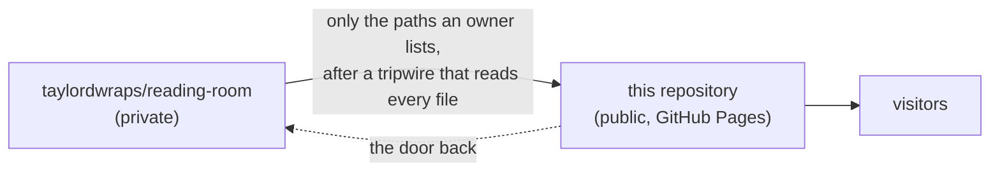

<picture>
  <source media="(prefers-color-scheme: dark)" srcset="banner/banner-dark.svg">
  
</picture>

# Taylor'd Wraps · the reading room, for visitors

*What the shop has chosen to share: its welcome, how its pages are read, and the procedures it keeps.*

**Read it at [taylordwraps.github.io/reading-room-public](https://taylordwraps.github.io/reading-room-public/).** The
front page links the welcome deck, the shop's two websites, every page that has been shared here, and the door to the
members' room.

## The members' room

Everything written for the shop is read first in a private room,
[`taylordwraps/reading-room`](https://github.com/taylordwraps/reading-room), by the shop's owners and the readers it
names. That link shows a 404 to anyone signed out or not yet invited: it means "not yet", not "broken". Access is the
shop's to give; ask the person who introduced you, and give only your GitHub username. Nobody here will ever ask for a
password, a code or a key.

## How this room works

When an owner decides a page is ready for visitors, they add it to the private room's list of pages to share, and an
automatic copy brings it here. The copy reads every file before it leaves (the words inside PDFs too; no keys, no agent
notes, nothing a machine or a person has not read) and records what it brought in `room-manifest.json`, which the front
page reads to list them.

| This repository holds | Written by |
| --- | --- |
| `index.html`, this `README.md`, `.nojekyll`, `banner/`, `LICENSE`, `LICENSE-CONTENT` | by hand, by pull request |
| every other page, and `room-manifest.json` | the automatic copy only; never edited here |

The front page is plain HTML with no build step: it works on a phone, follows your light or dark setting, and is served
by GitHub Pages from `main`. `main` carries a deletion-only rule, because the automatic copy writes to it.

Taylor'd Wraps on GitHub · [profile](https://github.com/taylordwraps) · code MIT, words CC BY-SA 4.0; Taylor'd Wraps' name and marks belong to the shop. Kept by the drasticstatic lab.
