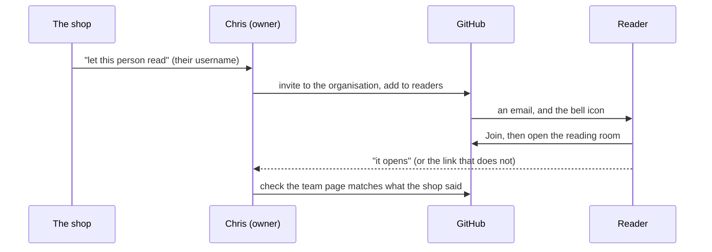

# SOP-GOV-001 · Who reads the reading room: two owners, one readers team


**Department:** GOV · **ID:** 001 · **Status:** draft (approved when tagged) · **Owner:** the organisation's owners; the lab executes · **Last changed:** 2026-11-01

##  Purpose
How a person is given **Read** on the shop's private reading room, how they accept, and how the lab checks it from their
side. In the fleet's larger organisations this procedure is about a board of directors and its committees; a shop has
neither, so here it is about the two owners and the people the shop chooses to let read.

##  Scope
`taylordwraps/reading-room`, through the closed team `readers`. **GitHub membership is not a role in the shop:** the shop
decides who reads; this procedure only opens the door for the people it names. Write access, the shop's own store and
anything with money in it are out of scope.

##  Roles
| Role | Does |
|---|---|
|  The shop (an owner's seat) | names who may read, by their GitHub username; can add or remove anyone itself |
|  Chris W (an owner, the lab's steward) | creates the team once, adds the people the shop names, checks |
|  Reader | accepts, reads, says when a link does not open |
|  Helper | prepares the commands for an owner; never adds a person on its own |

##  Prerequisites
The reading room exists under `taylordwraps` (an organisation, not a personal account: a personal private repository
cannot give anyone read-only access, SOP-IT-002). The person has their own account with two-factor sign-in (SOP-COM-001).

##  Who does what, in order



##  Steps: the lab, once
1. Create the team, closed, and give it Read on the room only:
   ```sh
   gh api -X POST orgs/taylordwraps/teams -f name=readers -f privacy=closed
   gh api -X PUT orgs/taylordwraps/teams/readers/repos/taylordwraps/reading-room -f permission=pull
   ```
   *You should see:* `readers` on the organisation's Teams page, with one repository.

##  Steps: each new reader
1. The shop names the person and their username, wherever it already talks to the lab. *You should see:* the username
   written down in the lab's notes, with the date and who asked.
2. Add them (an owner's action):
   ```sh
   gh api -X PUT orgs/taylordwraps/teams/readers/memberships/<login> -f role=member
   ```
   *You should see:* `"state": "pending"` until they accept, then `"active"`.
3. The reader accepts (SOP-COM-001, step 3) and opens `https://github.com/taylordwraps/reading-room`. *You should see:*
   the room's index.
4. **The shop's own seat** is an owner's, not a reader's: `gh api -X PUT orgs/taylordwraps/memberships/<login> -f role=admin`.
   Owners read everything and need no team.

##  Steps: a reader leaves
1. The shop says so (or the person asks). 2. `gh api -X DELETE orgs/taylordwraps/teams/readers/memberships/<login>`.
3. If they hold nothing else, remove them from the organisation on its **People** page. *You should see:* a 404 for them
   on the room's link.

##  Verification
`gh api orgs/taylordwraps/teams/readers/members --jq '.[].login'` lists exactly the people the shop named;
`gh api orgs/taylordwraps --jq .default_repository_permission` prints `none`, so nobody reads the room except owners
and the team.

##  Troubleshooting
| Symptom | Likely cause | What to do |
|---|---|---|
| The reader sees a 404 | invitation not accepted, signed in as another account, or two-factor sign-in not on | SOP-COM-001 steps 2 and 3; check the username |
| A member reads the room without being in `readers` | they are an owner, or the base permission was changed back to Read | read the base permission; never switch it back to fix one person |
| The invitation never arrives | sent to a username with a typo | delete the pending invitation on the People page, send again |

##  Related
- SOP-COM-001 *New to GitHub: your first hour* · SOP-GOV-002 *GitHub collaboration* (owners, teams, base permission none) · SOP-IT-002 *Reading room and helper access*
- The universal SOP-GOV-001 in `my-template/sop-template` (the same shape, for a board and its committees)

##  Change log
| Date | Change | By |
|---|---|---|
| 2026-11-01 | Drafted for the shop from the universal SOP-GOV-001: two owners and one readers team instead of a board and committees; the order of who does what in Mermaid | Alfred |
