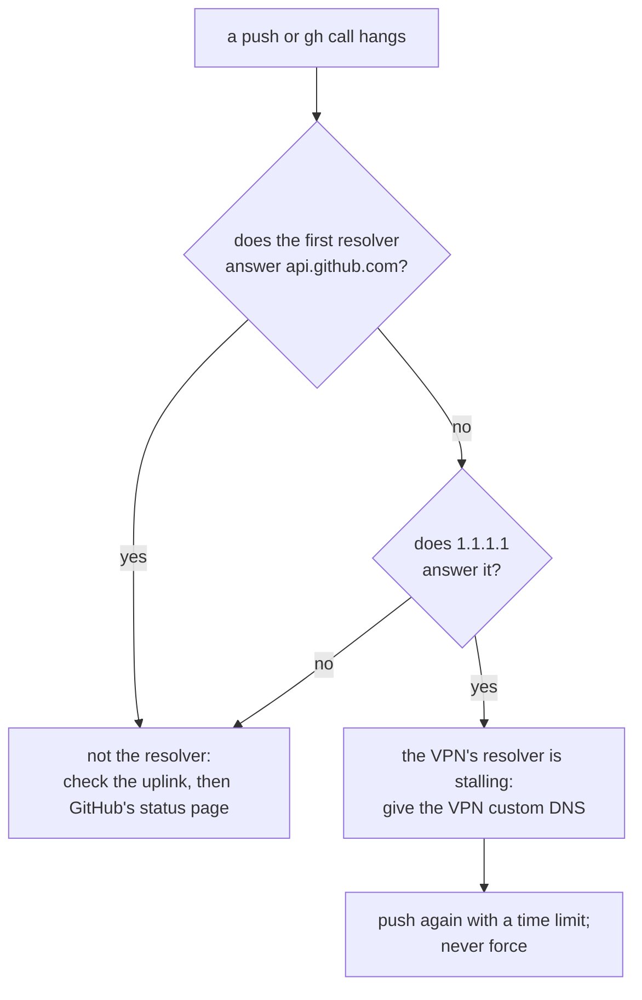

# SOP-IT-001 · When a change is late: the lab's network stalls, and why the websites don't

-64748b?style=flat-square)

**Department:** IT · **ID:** 001 · **Status:** draft (approved when tagged) · **Owner:** the lab · **Last changed:** 2026-11-01

##  Purpose
Sometimes a change the shop asked for takes longer than the lab said. The most common cause so far has nothing to do
with the websites: the lab's own computer, behind a VPN, intermittently loses the ability to look up some addresses on
the internet, and its pushes to GitHub hang. This procedure says what the shop sees (almost nothing), and how the lab
recognises and fixes it.

##  Scope
The lab's machines (macOS, a VPN, any uplink). The shop's websites are not in scope because they are not affected.

##  For the shop: what you will notice
- **The websites stay up.** They are served by GitHub Pages from GitHub's own servers. A stall on the lab's machine
  cannot take them down, slow them down, or change them.
- **A change may arrive later than promised.** The lab says so through Kenney and gives a new time. Nothing is lost; the
  change waits on the lab's machine until the network answers again.
- **There is nothing for the shop to do.**

##  For the lab: how to tell
- `git push`, `gh` or `curl` to one host hangs or says `i/o timeout`, while other sites load.
- A helper's network command times out; a long-running observer on the same machine goes quiet while its process lives.

##  Steps: check in one minute
1. Which resolver is first? `scutil --dns | head -20`. *You should see:* `nameserver[0]` and its interface; a `100.64.x.x`
   address on a `utun` interface is the VPN's resolver.
2. Does it answer for the failing host? `dig +short +time=3 +tries=1 api.github.com`. *You should see:* an answer within
   three seconds. Nothing, or `connection timed out`, is the stall.
3. Does a public resolver answer the same name? `dig +short +time=3 +tries=1 @1.1.1.1 api.github.com`. *You should see:*
   an answer. Step 2 failing while step 3 works means the VPN's resolver is the cause, not the uplink.

##  Steps: fix
1. **Give the VPN a resolver that works:** in the VPN app's settings, set a custom DNS (`1.1.1.1`, `1.0.0.1`), or turn
   off its DNS filtering and reconnect. *You should see:* step 2 answers.
2. **One-off stall:** reconnect the VPN, then `sudo dscacheutil -flushcache; sudo killall -HUP mDNSResponder`.
3. **Push with a time limit, and retry once:** `perl -e 'alarm 180; exec @ARGV' git push origin main`. If it fails twice,
   leave the commit in place, tell Kenney the new time, and push when the network answers. Never force-push to "fix" a
   push that timed out.
4. **Check the live page after the push lands** (SOP-OPS-001, step 5), then send the link.

##  Verification
Steps 2 and 3 answer alike; the push lands; the `Sync lanes` run is green; the live page shows the change.

##  Troubleshooting (grows)
| Date | Symptom | Finding | Fix |
|---|---|---|---|
| 2026-10-29/30 | the lab's observers silent for hours; `gh` and pushes timing out | the VPN's resolver (a `100.64.x.x` address on a `utun` interface) stopped answering some names; `1.1.1.1` answered | custom DNS in the VPN; pushes with a time limit, run in the background |

##  Related
- SOP-OPS-001 (the road and its last step), SOP-OPS-002 (never force)
- The universal SOP-IT-001 in `my-template/sop-template` (the full outage record across the fleet)

##  Change log
| Date | Change | By |
|---|---|---|
| 2026-10-31 | Drafted for the shop from the universal SOP-IT-001: what the shop notices (nothing breaks), the lab's one-minute check and fix | Alfred (FortunaTradesARB session) |
| 2026-11-01 | Moved into `taylordwraps/ops-standard-operating-procedures`. Lucid pass: icons, the one-minute check drawn as a decision in Mermaid | Alfred |
| 2026-11-01 | Made generic for the public copy: no VPN product named, and the finding gives the resolver's address range rather than the lab's own tunnel; same steps, same fix | Alfred |
