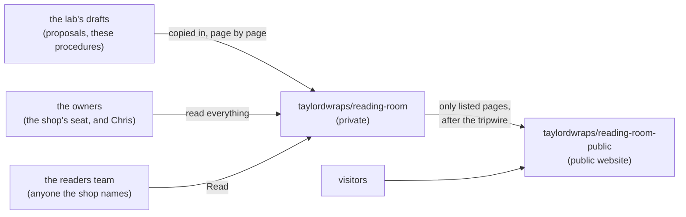

# SOP-IT-002 · Reading room and helper access: nothing to sign up for, and a room kept ready


**Department:** IT · **ID:** 002 · **Status:** draft (approved when tagged) · **Owner:** the lab · **Last changed:** 2026-11-01

##  Purpose
How the shop (and anyone helping the shop, a person or an AI assistant) reads everything that was made for it, with the
smallest possible access: today, none at all.

##  Scope
The two websites, their public source, the slides, and the private drafts written for the shop (proposals and these
procedures). Never passwords, store logins, payment details or anything from the shop's own accounts.

##  Roles
| Role | Does |
|---|---|
| The shop | opens links; asks Kenney for anything else |
| The shop's helper (an employee, a web person, an AI assistant) | reads what is public; asks through Kenney for the rest; never receives a password |
| Kenney | passes PDFs and links |
| The lab | sends PDFs; opens a door (below) only if the shop asks for one |

##  Steps: read, with no account
1. **The websites:** open https://drasticstatic.github.io/taylordwraps-nextjs-preview/ (THE CARPORT) and
   https://drasticstatic.github.io/taylordwraps-public-preview/ (THE CAR SHOW) on any phone or computer. *You should
   see:* the website; no sign-in is ever asked for.
2. **The slides:** https://drasticstatic.github.io/taylordwraps-public-preview/decks/hello-taylor.marp.html (arrow keys or
   swipe), or the PDF beside it. *You should see:* "Hello, Taylor".
3. **The private drafts** (the proposals, these procedures) arrive as **PDFs through Kenney**. *You should see:* a PDF you
   can open, print or forward. Nobody needs an account to read them.
4. **The public source** of each website is readable by anyone at `github.com/drasticstatic/taylordwraps-nextjs-preview`
   and `github.com/drasticstatic/taylordwraps-public-preview`. Ideas and issues are welcome there; changes still go
   through Kenney (SOP-OPS-001).

##  Steps: bring a helper
1. **A person helping the shop** reads the same links. If they want to suggest a change, the message goes to Kenney like
   any other request. *You should see:* no access granted to anyone, and nothing missing.
2. **An AI assistant** can read the websites, the public repositories and any PDF it is given, with no credential.
   Ask it to summarise one page without changing anything. *You should see:* a correct summary.
3. **Never give a helper a password,** a store login, or a code sent by text. Nothing here needs one.

##  The reading room, kept ready
The workshop is a private repository in Chris's personal GitHub account. GitHub cannot give anyone *read-only* access to a
personal private repository (an invitation for read access fails with error 422), so the lab will not "share the
repository". The door is the shop's own organisation instead, `taylordwraps`, which holds a **reading room**: a private
room for the shop's chosen people, and a public room beside it for what is ready for visitors. It is set up and waiting;
nothing in it needs the shop until the shop wants it, and PDFs through Kenney keep working either way.



| Piece | What it is | Address |
|---|---|---|
|  Private room | `taylordwraps/reading-room`: the drafts written for the shop, each a page with its PDF; its README is the index | `https://github.com/taylordwraps/reading-room` |
|  Readers team | `taylordwraps/readers`, a closed team with **Read** on the private room and nothing else | `https://github.com/orgs/taylordwraps/teams/readers` |
|  Public room | `taylordwraps/reading-room-public`: only the pages listed in the private room's `PUBLIC-ALLOWLIST.txt`, with a front page on GitHub Pages | `https://taylordwraps.github.io/reading-room-public/` |
|  Owners | the people who can change anything in the organisation: **two or more**, so no single person is ever the only way in | the organisation's **People** page |

**Why the shop's seat is an owner's.** If only one person (Chris) could open the shop's GitHub home, the shop would
depend on him for its own pages. With the shop as an owner too, either can invite, remove, or carry on alone, and the
organisation outlives any one person's account (SOP-GOV-002).

###  Steps: the day the shop wants to read in a browser
1. **Your own account, first.** SOP-COM-001 is the whole first hour: you type your own password, turn on two-factor
   sign-in, and send only your username. *You should see:* your empty dashboard.
2. **Accept the invitation** (email, or the bell icon). *You should see:* Taylor'd Wraps under your profile's
   Organizations.
3. **Open the room:** `https://github.com/taylordwraps/reading-room` while signed in. *You should see:* its index, not a
   404. A 404 means signed out, or the invitation still waiting.
4. **Read in the browser,** or open a PDF from the `pdf/` folder beside each page.

###  Steps: a helper that reads the private room with you
1. Ask whether the helper already has an approved GitHub connection that reaches the room. *If yes:* stop here.
2. If a key is needed, create a **fine-grained personal access token** in your own account: resource owner
   `taylordwraps`; only `reading-room`; **Contents: Read-only**; a short expiry. *You should see:* the token once; paste it
   only into the helper's own credential store, never into a chat.
3. Ask the helper to read one named page and summarise it without changing anything. *You should see:* a correct summary
   and no commit.
4. Revoke the token when the purpose ends, a device is lost, or exposure is suspected (Settings → Developer settings →
   Personal access tokens).

###  Steps: the steward (Chris, once)
```sh
gh repo create taylordwraps/reading-room --private        # and reading-room-public --public
gh api -X POST orgs/taylordwraps/teams -f name=readers -f privacy=closed
gh api -X PUT orgs/taylordwraps/teams/readers/repos/taylordwraps/reading-room -f permission=pull
gh api -X PUT orgs/taylordwraps/memberships/<login> -f role=admin    # an owner's seat, sent to a username the shop chose
```
*You should see:* the invitation waiting on the organisation's **People** page; `gh api orgs/taylordwraps --jq
.default_repository_permission` prints `none` (set on 2026-11-01).

##  Verification
The shop and its helper open every public link above without signing in; the PDFs open; no credential was created or
shared. Once the shop has a seat: the private room opens from the shop's own account, and a helper's read test passes.

##  Troubleshooting
| Symptom | Likely cause | What to do |
|---|---|---|
| A link shows "404" | the link points at the private workshop (`github.com/drasticstatic/taylordwraps/…`), not a public copy | ask Kenney for the PDF instead; the lab sends public links only |
| The website looks out of date | the browser cached the page | reload with the cache cleared; the live copy updates within minutes of a change |
| Someone asks the shop for a login "to update the site" | not the lab; the lab never needs one | say no; tell Kenney |
| `github.com/taylordwraps/reading-room` shows 404 | signed out, a different account, or the invitation not yet accepted | sign in; accept the invitation; tell Kenney or Chris the username you used |
| A helper's token reaches public repositories only | the token is still pending an owner's approval | an owner approves it under the organisation's personal access tokens |

##  Related
- SOP-OPS-001 (asking for a change; what the shop never needs to do), SOP-IT-003 (what stays in the shop's browser)
- SOP-COM-001 (the first hour on GitHub), SOP-GOV-001 (who reads the room), SOP-GOV-002 (owners, teams, base permission none), SOP-OPS-003 (what the public room may carry)
- The universal SOP-IT-002 in `my-template/sop-template` (reading rooms, readers teams, fine-grained tokens)

##  Change log
| Date | Change | By |
|---|---|---|
| 2026-10-31 | Drafted for the shop from the universal SOP-IT-002: read with no account, PDFs through Kenney, helpers without credentials, the reading room kept as a later door | Alfred (FortunaTradesARB session) |
| 2026-11-01 | Moved into `taylordwraps/ops-standard-operating-procedures`. The reading room is kept ready in the shop's own organisation: the route in Mermaid, the address table, the shop's seat as an owner (no single point of failure), a helper's read-only key, the steward's commands | Alfred |
