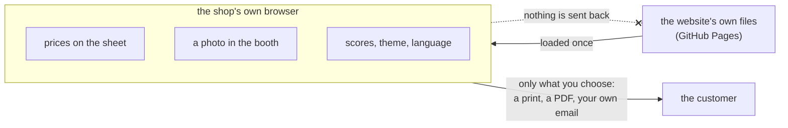

# SOP-IT-003 · Local by default: what stays in the shop's own browser

**Department:** IT · **ID:** 003 · **Status:** draft (approved when tagged) · **Owner:** the lab · **Last changed:** 2026-11-01

##  Purpose
The fleet's rule for anything that runs on someone's machine is *local by default*: it answers only that machine unless
someone opens it on purpose. For the shop, the same rule means the websites keep the shop's numbers, photos and choices in
the browser that made them, and send nothing anywhere. This procedure says what stays local, how to use it, and what to
do when moving to another device.

##  Scope
Both websites, on any device the shop or its visitors use. Not the shop's own store (taylordwraps.com), which has its
own rules.

##  What stays local
| Thing | Where it lives | Sent anywhere? |
|---|---|---|
| **Prices on the proposal sheet** (THE CARPORT `/proposal`) | in the browser you typed them in, and only if you ask it to remember them | **never**; prices never enter the workshop either (`ALLOWLIST.md`) |
| **The Car Show's proposal sheet** (`proposal.html`) | nowhere: it is a static sheet; print or save as PDF | never |
| **A photo uploaded to the booth or the visualizer** | in that browser tab, for as long as it is open | **never uploaded**; the film is laid on it in the browser |
| **Arcade scores, theme, language, effects** | that browser | never; `COPY MY RUN` puts a line on your clipboard, nothing more |
| **Wrap Origin fingerprints** | computed in the browser and checked against the site's own list | never |
| **A work order or ticket** | ends in a phone call or an email you send yourself | only what you choose to send, to the shop |

##  Steps: the proposal sheet, on the shop's computer
1. Open THE CARPORT's proposal sheet (`/proposal`) on the computer the shop uses at the counter. *You should see:* blank
   price fields.
2. Type the shop's prices and tick the services; choose to have the browser remember them if you want them next time.
   *You should see:* the sheet in the shop's colours, with your numbers.
3. Print, or save as PDF, and hand it to the customer. *You should see:* a clean one-page sheet.
4. **Another device** (a tablet, a second computer) starts blank: type the prices there too. Clearing the browser's
   site data clears them; keep your own copy of the rate card wherever you keep it today.

##  For the lab: keeping it local
- No analytics, no tracking, no accounts, no forms that post anywhere; a new feature that would send data off the
  device is a proposal first, never a quiet addition.
- The Carport's build tripwire fails on anything shaped like a price in the source; never weaken it to pass.
- Any dashboard or tool the lab runs for this work on its own machine listens on that machine only (the universal
  SOP-IT-003).
- The lab's Claude Code sessions run the built-in **You should know** reader (`cc-plugin-you-should-know@builtin`), the
  second reader that first spelled out the local-by-default rule. It has no tools: a heads-up from it is a reason to check,
  never a check done, and each check it makes is one extra model request. To know it runs, look for its **Heads up** note in
  the session; it is turned on with `/plugin enable cc-plugin-you-should-know@builtin` and needs no restart. The full note
  is in the universal SOP-IT-003 ("Where the heads-up came from").

##  Verification
With the browser's developer tools open on the network tab, filling the proposal sheet, uploading a photo to the booth and
playing a cabinet make no request to any server other than the website's own files.

##  Troubleshooting
| Symptom | Likely cause | What to do |
|---|---|---|
| The prices are gone | a different browser or device, private browsing, or cleared site data | type them again; they were never stored anywhere else, by design |
| The uploaded photo disappeared | the tab was closed | upload it again; nothing was kept |
| Someone says the website "collected" their details | it cannot: nothing is collected | point them to this page; the shop's store has its own policy |

##  Related
- SOP-IT-002 (reading with no account), SOP-OPS-001 (what the shop never needs to do)
- `ALLOWLIST.md` (prices never in git), `carport/src/app/proposal/`, `carshow/proposal.html`
- The universal SOP-IT-003 in `my-template/sop-template` (observer dashboards, local by default)

##  Change log
| Date | Change | By |
|---|---|---|
| 2026-10-31 | Drafted for the shop from the universal SOP-IT-003: what stays in the browser, the proposal sheet on the shop's computer, the lab's rule | Alfred (FortunaTradesARB session) |
| 2026-10-31 | The "You should know" reader noted for the lab (from Christopher's screenshot of its heads-up, via the universal SOP-IT-003) | Alfred (FortunaTradesARB session, review) |
| 2026-11-01 | Moved into `taylordwraps/ops-standard-operating-procedures`. Lucid pass: icons, what stays in the browser drawn in Mermaid | Alfred |
