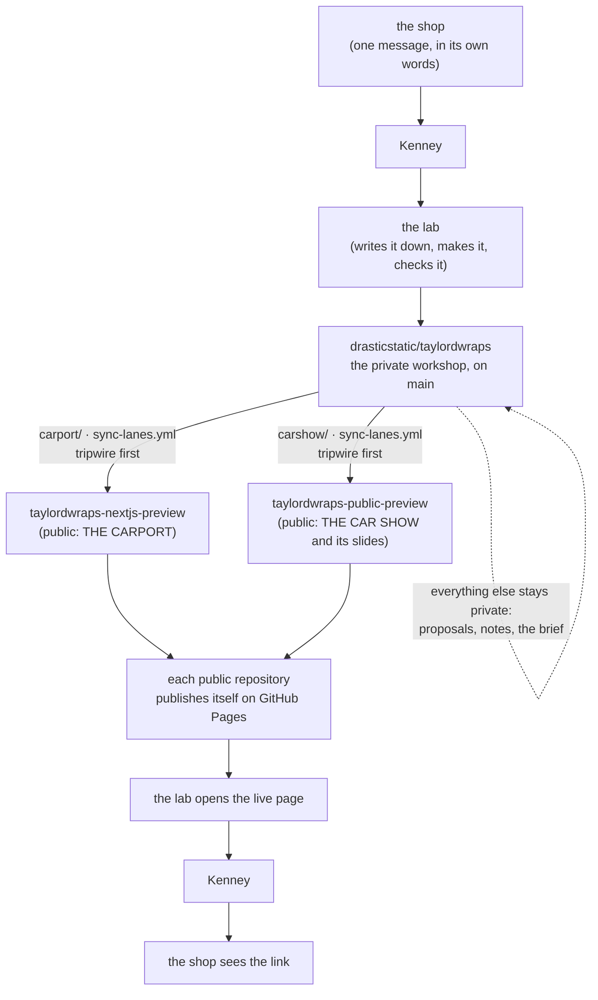

# SOP-OPS-001 · How a change travels: Taylor's word, Kenney, the workshop, the two public websites

**Department:** OPS · **ID:** 001 · **Status:** draft (approved when tagged) · **Owner:** the lab (repository steward) · **Last changed:** 2026-11-01

##  Purpose
So that the shop always knows how to get something changed (one message), what happens after that message, and which
copy of the website anyone is looking at; and so that nothing reaches the public unless it sits in one of the two
folders that are meant to.

##  Scope
The two showcase websites built for Taylor'd Wraps (THE CARPORT and THE CAR SHOW) and the private workshop repository
that feeds them, `drasticstatic/taylordwraps`. Not the shop's own store at taylordwraps.com, which belongs to the shop
and is never touched from here.

The shop also has its own home on GitHub, the organisation `taylordwraps` (these procedures, the reading room, the
proposals and the welcome deck live there). It changes nothing below: the websites are still made in the workshop, and
asking is still one message. Files named here without a repository (`ALLOWLIST.md`, `DEPLOY.md`, `pending-tasks.md`,
`scripts/…`, `carport/`, `carshow/`) are in the workshop.

##  Roles
| Role | Does |
|---|---|
| **The shop** (Taylor, or anyone she names) | says what she'd like, in her own words, to Kenney; says yes or no to what comes back |
| **Kenney** | passes the message to the lab and the link back to the shop; nothing technical |
| **The lab** (Chris, and his helpers Alfred and Littlebird) | writes the request down, makes the change, checks it, ships it, sends the link |
| **The workflows** (GitHub Actions) | copy the public folders to the public repositories and publish the websites; nobody edits those by hand |

##  Asking for a change, through Kenney
This is the whole procedure on the shop's side.

1. **Tell Kenney what you'd like**, however you already talk to him: a text, a call, in person. Plain words are perfect:
   "the van in matte black", "my number is wrong on the counter", "use this photo of the Sprinter", "take it all down".
   A photo or a screenshot helps; an exact wording helps when it's text on the page. *You should see:* Kenney says he's
   passed it on.
2. **Photos travel the same way.** Send them to Kenney (or straight to the lab, if Kenney introduces you). Only photos the
   shop owns or has permission to use; the lab imports them by hand and records a fingerprint of each one, so the
   website can prove where its pictures came from.
3. **Wait for the link.** A small change (a photo, a line of text, a colour) comes back as a link to the live page; the
   lab says when to expect it. *You should see:* the change on the website, on your phone, without logging in to anything.
4. **Say yes, or say what's still off.** Back through Kenney. There is no form and no approval button; your reply is the
   approval.

**Bigger work** (a new section, a booking flow, a real storefront off GitHub) is written down first, with what it is and
what it would cost, **before** anything is built; the shop says yes or no. **Taking it down** is one message too: the lab
unpublishes both websites the same day.

##  What the shop never needs to do
- **Make a GitHub account**, learn git, or read code. The websites are in GitHub because that is where the lab works;
  the shop never has to go there. The shop's own GitHub home (`taylordwraps`) is set up and waiting, with its owner's
  seat kept for the shop, so that the day the shop wants a key of its own it is already there (SOP-COM-001 is the first
  hour). Until then, nothing in it needs the shop.
- **Give anyone a password, a login, a code or a key**, for anything: not the store, not email, not social media. If
  anyone ever asks for one in the lab's name, the answer is no; tell Kenney.
- **Pay anything for the showcase.** It's a gift. Hosting is free (GitHub Pages); a custom address, if the shop ever
  wants one, is about $12 a year and is the shop's own.
- **Install anything, or keep a computer running.** The websites are served by GitHub, not from anyone's machine; they
  stay up when every laptop involved is closed.
- **Approve pull requests, merge anything, or check a build.** Those are the lab's jobs (SOP-OPS-002).
- **Store prices, customer details or payments here.** Prices never enter the workshop; the proposal sheets ship blank
  and remember the shop's numbers only in the shop's own browser (SOP-IT-003). Payments stay on taylordwraps.com.
- **Keep anything in sync.** The public copies update themselves; nobody copies files by hand.

##  The road

 one message ·  the workshop ·  the tripwire ·  two public websites ·  the link back

- **One workshop, two lanes.** The private repository holds everything; only the `carport/` and `carshow/` folders (and
  the licence files) ever leave it. `ALLOWLIST.md` says what may travel, and a tripwire script fails the copy if a
  private folder or anything shaped like a secret is inside a lane.
- **Each public repository is a mirror,** one `sync:` commit per change, each naming the private commit it came from. A
  drift guard stops the copy if someone edited a public repository directly, and names the file to bring home first.
- **Each lane has its own key.** A write deploy key that opens exactly one public repository, held as a secret in the
  workshop (`DEPLOY_KEY_CARPORT`, `DEPLOY_KEY_CARSHOW`). If a key is missing, the copy warns and skips; nothing breaks.

##  "Preview" in the names
Both public repositories have *preview* in their names because, until the shop says yes, the whole showcase is a
preview: a gift being shown, not the shop's real site. That is the only meaning here. This workshop has **no `preview`
branch** and no rehearsal lane; changes are made on `main` and the public copies follow it. (In the fleet's other
organisations, *preview* also names a rehearsal branch and a rehearsal website; `my-template`'s SOP-OPS-001 explains
those. If the shop ever wants to see changes before they go live, that is how it would be added: a `preview` branch,
a rehearsal website, and the shop's yes as the Promote.)

**Which one am I looking at?** An address starting `drasticstatic.github.io/taylordwraps-` is the live showcase. A
`github.com/drasticstatic/taylordwraps-…` address is the public source of that website (readable, never edited by hand).
`taylordwraps.com` is the shop's own store, untouched by any of this. A `github.com/taylordwraps/…` address is the shop's
own GitHub home: its profile and welcome deck are public, its reading room and proposals are private.

##  Steps (the lab)
1. **Write the request down** in `pending-tasks.md` under today's date, in the shop's words. *You should see:* the line
   committed, so nothing depends on anyone's memory.
2. **Make the change in the lane folder** (`carport/` or `carshow/`, never the public repositories). New photos go into
   `carshow/assets/` and `carport/public/assets/`, then `node scripts/hash-shared-assets.mjs` refreshes the fingerprints.
3. **Run the gates** (`CLAUDE.md`): the Carport build and smoke tests, the Car Show assemble and reference check, the
   tripwire. Since 2026-11-01 the sync also reads the words of every PDF and office file in a lane before it leaves
   (`scripts/scan-public-lane.sh`, SOP-OPS-003). *You should see:* every gate green.
4. **Commit and push `main`.** *You should see:* the `Sync lanes` workflow run once per changed lane, then each public
   repository's own deploy.
5. **Open the live page** on a phone-sized screen, not just the source folder. *You should see:* the change, live.
6. **Send Kenney the link**, with one line on what changed. Tick the line in `pending-tasks.md`.

##  Verification
The public repository's latest commit is a `sync:` commit naming the private commit you pushed; the live page shows the
change; `pending-tasks.md` has the request and its tick.

##  Troubleshooting
| Symptom | Likely cause | What to do |
|---|---|---|
| The live page still shows the old version | the sync or the deploy has not finished, or the browser cached the page | wait two minutes; reload with the cache cleared; check the Actions tab of both repositories |
| The sync failed with "edited directly on …" | someone edited a public repository in GitHub's editor | bring that edit into the lane folder (keep any links Chris added), push again |
| The sync warns "secret … is not set" | a lane's deploy key is missing | `sh scripts/setup-lane-keys.sh` (the lab, once) |
| The tripwire failed | a private folder or a secret-shaped string got into a lane | move it out of the lane; never weaken the tripwire to pass |
| The shop asked for something and heard nothing | the message stopped somewhere between Kenney and the lab | Kenney asks the lab directly; the lab replies with where it stands, even if the change itself takes longer |

##  Related
- `ALLOWLIST.md`, `DEPLOY.md` (the topology and the gates), `.github/workflows/sync-lanes.yml`, `scripts/lane-tripwire.mjs`
- SOP-OPS-002 (who says yes), SOP-IT-001 (when a change is late), SOP-IT-003 (what stays in the shop's browser)
- Proposal 001 *A website that wraps itself* (in the workshop's `proposals/`); the slides *Hello, Taylor* (`carshow/decks/`)
- SOP-OPS-003 (what may leave a private repository, and the tripwire that reads every file), SOP-COM-001 (the shop's first hour on GitHub, whenever it wants one)
- The universal SOP-OPS-001 in `my-template/sop-template` (the `preview` branch and the publish-preview lanes)

##  Change log
| Date | Change | By |
|---|---|---|
| 2026-10-31 | Drafted for the shop from the universal SOP-OPS-001: the road through Kenney, asking for a change, what the shop never needs to do, "preview" in the names | Alfred (FortunaTradesARB session) |
| 2026-11-01 | Moved into the shop's own procedures repository (`taylordwraps/ops-standard-operating-procedures`). Lucid pass: an icon on every section, the road drawn in Mermaid; the shop's GitHub home named, and waiting; the PDF-reading tripwire on the lanes | Alfred |
