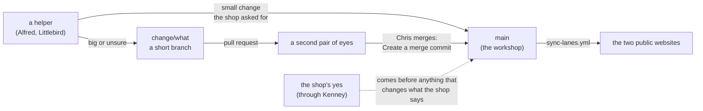

# SOP-OPS-002 · Pull requests and Promotes: who makes the change, who says yes, why the record is kept whole


**Department:** OPS · **ID:** 002 · **Status:** draft (approved when tagged) · **Owner:** the lab (repository steward) · **Last changed:** 2026-11-01

##  Purpose
Who is allowed to make a change to the workshop, who says yes to it, and how the record of who did what stays whole.
In the fleet's larger organisations this is done with pull requests and "Promotes"; this procedure says how much of that
a two-website showcase needs today (very little) and what it would grow into.

##  Scope
`drasticstatic/taylordwraps` (private, the workshop) and its two public mirrors, and the shop's own GitHub home
`taylordwraps` (its profile, procedures, proposals and reading room). The shop has no step in this procedure: its yes
arrives through Kenney (SOP-OPS-001) and that yes is the approval.

##  Roles
| Role | Does |
|---|---|
| Helper (Alfred in Claude Code, Littlebird) | edits, runs the gates, commits with attribution, pushes, sends the link; **never** changes a public repository by hand |
| Chris (the repository owner) | decides what ships; the only person who merges, when there is anything to merge |
| The shop | says yes or no to what it sees, through Kenney |
| The workflows | the only writers to the public repositories |

##  How a change is accepted here, today
- **The working branch is `main`.** There is no `preview` branch in this workshop (SOP-OPS-001, *"Preview" in the
  names*). The lab commits to `main` and the public copies follow it.
- **The shop's approval comes before or after the push, never by GitHub.** Small changes the shop asked for go live and
  the link goes back; anything that changes what the shop says about itself (wording, prices shown, a new section) waits
  for the shop's yes before it ships.
- **A pull request is used when a change needs a second pair of eyes** (a big change, or anything a helper is unsure
  of): a short-lived branch, a pull request into `main`, Chris merges.
  ```sh
  git switch -c change/<what>            # the helper
  git push -u origin change/<what>
  gh pr create --base main --head change/<what> --title "<what>" --body "<what changes, and the shop's words if it asked>"
  ```
  *You should see:* a link of the form `https://github.com/drasticstatic/taylordwraps/pull/<n>`. The helper sends the link;
  Chris merges with **Create a merge commit**.



###  In the shop's own GitHub home
The repositories in `taylordwraps` (`.github`, `ops-standard-operating-procedures`, `proposals`, `reading-room`, and
their public rooms) work the same way: a helper commits or opens a pull request into `main`; **a person with the role
merges, with a merge commit**; a helper never merges. Their public rooms (`-public`) are written only by their syncs.
There is no `preview` branch in them either.

##  If the shop ever wants to see changes before they go live
That is the fleet's *Promote* road, and it can be added in an afternoon: a `preview` branch, a rehearsal copy of each
website, and a pull request from `preview` into `main` titled `Promote: <what>` that waits for the shop's yes. Until the
shop asks for it, it would only add steps.

##  Why merge, never squash
Every commit in the fleet carries who made it and under which session (`Co-Authored-By` and the session line). A
squash folds many commits into one and erases that record; a merge commit keeps it. On 2026-11-01 the workshop and both
twins still allowed squash and rebase merges (read from the API); the owner closes that with:
```sh
for r in taylordwraps taylordwraps-public-preview taylordwraps-nextjs-preview; do
  gh api -X PATCH repos/drasticstatic/$r -F allow_squash_merge=false -F allow_rebase_merge=false -F allow_merge_commit=true
done
```
The shop's own repositories are created with merge commits only (the same three settings, on each `taylordwraps/…`
repository).

##  What is protected, and what is not
| Repository | Kind | Protection | Who writes |
|---|---|---|---|
| `drasticstatic/taylordwraps` | private, personal account | **none possible** on the free plan (GitHub answers "Upgrade to GitHub Pro"); kept by habit and by who holds write | Chris and his helpers |
| `drasticstatic/taylordwraps-public-preview` | public twin (THE CAR SHOW) | a ruleset is available (public repository). This sync adds ordinary commits and **never force-pushes**, so the strict ruleset (no deletion, no force-push; `my-template/branch-protection/ruleset.json`) fits, unlike the fleet's filter-repo twins that need deletion-only; none set as of 2026-10-31 | the sync workflow only |
| `drasticstatic/taylordwraps-nextjs-preview` | public twin (THE CARPORT) | the same | the sync workflow only |
| `taylordwraps/.github`, `ops-standard-operating-procedures`, `proposals`, `reading-room` | the shop's home (the profile public, the rest private) | on the free plan, no ruleset on the private ones; merge commits only; base permission **none**, so only a team or an owner reads a private one (SOP-GOV-002) | the owners and their helpers, by pull request where a second look helps |
| `taylordwraps/reading-room-public`, `ops-standard-operating-procedures-public` | public rooms | the deletion-only ruleset (`my-template/branch-protection/`) | their sync workflows only |

The twins are never edited by hand. If someone does (a README tweak in GitHub's editor), the next sync stops and names
the file; the edit is brought into the lane folder and the sync runs again.

##  Verification
`git log -1` on `main` shows the commit with its attribution lines; the twin's latest commit is a `sync:` commit naming
it; a merged pull request, when there was one, shows a merge commit with two parents.

##  Troubleshooting
| Symptom | Likely cause | What to do |
|---|---|---|
| "not fast-forward" when the helper pushes | someone else pushed meanwhile | `git pull --rebase --autostash`, then push again; never force |
| The commit is refused by the hook | the attribution lines are missing or misspelled | read the hook's expected format, fix the message; never skip the hook |
| The push or `gh` hangs | the lab's network resolver is stalling (SOP-IT-001) | wait or switch DNS; the helper hands back the command to retry |
| The merge button offers only "Squash and merge" | merge methods were changed | the owner runs the command above |

##  Related
- SOP-OPS-001 (the road), SOP-IT-001 (when a change is late), SOP-OPS-003 (what the public rooms may carry), SOP-GOV-002 (owners, teams, base permission)
- [`LEGEND.md`](../LEGEND.md): how each repository is guarded, generated by `sh scripts/legend.sh taylordwraps drasticstatic`
- The universal SOP-OPS-002 in `my-template/sop-template` (Promotes, the fleet legend, `scripts/legend.sh`)
- `my-template/AGENT-SYNC/README.md` (the attribution spec), `my-template/branch-protection/` (the two rulesets and when each fits)

##  Change log
| Date | Change | By |
|---|---|---|
| 2026-10-31 | Drafted for the shop from the universal SOP-OPS-002: `main` as the working branch, pull requests when a change needs a second look, the Promote road kept for later, this repository's protection read from the API | Alfred (FortunaTradesARB session) |
| 2026-11-01 | Moved into `taylordwraps/ops-standard-operating-procedures`. Lucid pass: icons, the acceptance road in Mermaid; the shop's own repositories added (merge commits only, helpers never merge); merge settings re-read for the workshop and both twins | Alfred |
