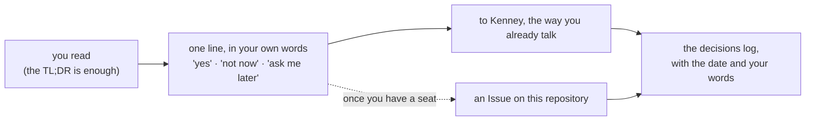
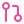

# Start here

### How this folder reads, how to answer if you ever want to, and how to bring your helper along

*Read this one once. Every other proposal assumes you have.*

---

##  TL;DR

> [!TIP]
> **Five lines, if that's all you read.**
>
> 1.  **A proposal is one folder with one page.** The five-line TL;DR comes first, the detail folds away underneath, and the same page is a **PDF** in [`pdf/`](../pdf/) for anyone who would rather not open GitHub.
> 2.  **Nothing here is an ask.** Everything written for Taylor'd Wraps is offered. *"Not now"* is a complete answer, and so is silence: nothing changes until the shop says so.
> 3.  **Bring your helper.** If you use ChatGPT, Claude or another assistant, it can read these pages with you, never more than you can (below, and proposal 001).
> 4.  **The markdown travels with the PDF.** When a proposal is sent as a PDF, the `.md` goes with it, so a helper reads the words, not a picture of a page.
> 5.  **Nothing is published by a proposal.** A proposal offers; the shop decides. The shop's store, its accounts and its prices are never touched from here.

---

##  How a proposal is shaped

| Part | What it is for |
|---|---|
|  **TL;DR** | five lines or fewer; if you read nothing else, read these |
|  **What's offered** | the idea in plain words: how things are today, beside what is offered |
|  **Itinerary** | the stops, each lighting up as it is done |
|  **Questions** | usually none; when there is one, it says who could answer it and that "not now" is fine |
|  **Decisions log** | what was chosen, when, and by whom; blank until the shop chooses |
|  **Details** | the technical material, folded into sections you can open or ignore |
|  **Sources** | where each fact came from, with the date it was read |

The icons beside each idea are a reading aid, not decoration: the same icon means the same thing on every page.

### Status words

&nbsp;**offered**: written, waiting on nothing but the shop's interest &nbsp;·&nbsp; &nbsp;**proposed**: written, a choice is open &nbsp;·&nbsp; &nbsp;**in progress**: agreed and under way &nbsp;·&nbsp; &nbsp;**done** &nbsp;·&nbsp; &nbsp;**idea**: not yet shared with anyone

---

##  How to answer, if you want to

1. **Read the TL;DR.** If it is enough, answer from it, or don't answer at all.
2. **One line each**, in any order, in your own words: *"001 yes, later · the van in blue"*.
3. **Send it the way you already talk:** to Kenney, or to Chris once you have met. Once the shop has its own seat here,
   an Issue on this repository works too.
4. **Then the proposal changes, not before.** Your answer goes into its decisions log with the date.

---

##  Bring your helper (three steps)

> [!IMPORTANT]
> **Your AI helper can read these pages with you.** Any assistant that can read a PDF or connect to GitHub (ChatGPT,
> Claude, and others) can summarise a proposal, explain a word, and help you answer in your own words.
>
> 1. **Give it the page.** The simplest way: hand it the PDF *and* the `.md` beside it. Once the shop has its seat, a
>    helper can also be connected to GitHub with read-only access to the reading room ([SOP-IT-002](https://github.com/taylordwraps/ops-standard-operating-procedures/blob/main/IT/SOP-IT-002-reading-room-and-helper-access.md), and proposal 001).
> 2. **Paste a first message:** *"Read Start here, then tell me in five lines what is in this folder and whether anything
>    is waiting on me. Don't change anything."*
> 3. **Ask in your own words.** A helper never needs a password, a sign-in code or a store login, and never gets one.

---

##  The markdown beside the PDF

Every proposal exists twice: the `README.md` you are reading, and `pdf/NNN-name.pdf`, rendered from it. The PDF is for
eyes; the markdown is for helpers. A helper given only a PDF has to rebuild the words from a picture of a page, and loses
the links and the exact phrasing. So whenever a proposal is sent on, **both files go**. The full note:
[Markdown beside the PDF](https://github.com/drasticstatic/my-template/blob/main/walkthroughs/MARKDOWN-BESIDE-PDF.md).

---

##  Five GitHub words, and no more

| Word | Plain meaning |
|---|---|
|  **Repository** | a folder with a memory: every change to every file, with who made it and when |
|  **Branch** | one line of that history; `main` is the copy everyone treats as real |
|  **Pull request** | *"please look at this change and, if you agree, make it the real one"*; a person says yes |
|  **Issue** | a numbered conversation attached to a repository; the simplest way to ask or answer |
|  **Merge** | accepting a pull request, so the change lands; a person does it, never a helper |

That is all a reader needs. [SOP-COM-001](https://github.com/taylordwraps/ops-standard-operating-procedures/blob/main/COM/SOP-COM-001-new-to-github-your-first-hour.md)
is the first hour on GitHub, whenever it is wanted.

---

##  Where things live

| | Place | What it holds |
|---|---|---|
|  | [this repository](https://github.com/taylordwraps/proposals) (`taylordwraps/proposals`, private) | every proposal written for the shop, numbered, with the index on its front page |
|  | [`taylordwraps/reading-room`](https://github.com/taylordwraps/reading-room) (private) | a copy of these proposals and the procedures, each a page and a PDF: the one place to read everything |
|  | [`taylordwraps/ops-standard-operating-procedures`](https://github.com/taylordwraps/ops-standard-operating-procedures) (private) | the procedures: how a change travels, what the shop never needs to do |
|  | [github.com/taylordwraps](https://github.com/taylordwraps) (public) | the shop's profile and its welcome deck |
|  | [THE CARPORT](https://drasticstatic.github.io/taylordwraps-nextjs-preview/) and [THE CAR SHOW](https://drasticstatic.github.io/taylordwraps-public-preview/) (public) | the two websites built as a gift; no sign-in, ever |
|  | [`ONBOARDING.md`](https://github.com/taylordwraps/.github/blob/main/ONBOARDING.md) (public) | the welcome for people and helpers: who is who, what is private, how the work is done |

A private link shows a 404 to anyone not signed in with a seat; that means "not yet", not "broken".

---

Taylor'd Wraps on GitHub · kept by the drasticstatic lab · Icons: Lucide (ISC). This page follows the pattern every organisation's proposals repository opens with; the template lives in <a href="https://github.com/drasticstatic/my-template/tree/main/proposals-template">my-template</a>.

